<h1 align="center">UVM-Based Functional Verification of Serial Communication Protocols</h1>
<h3 align="center">UART (TX / RX) &nbsp;•&nbsp; I2C (1 Master, 3 Slaves)</h3>

<p align="center">
  
  
  
  
</p>

<p align="center">
  <a href="https://drive.google.com/file/d/11vLfl7d8sVwdOt92LVrWl-U2VWgPQ9Em/view?usp=drive_link"></a>
  &nbsp;
  <a href="https://drive.google.com/file/d/1bBfQI8Mg996yplzKh2AoKD3W4LAm1DOY/view?usp=drive_link"></a>
</p>

<p align="center">
  <a href="https://github.com/vijay-2020-vijay"></a>
  &nbsp;
  <a href="https://www.linkedin.com/in/rabisankar-maity-98572b1b7"></a>
</p>

---

⬜ Overview

This repository contains complete **UVM (Universal Verification Methodology)** verification environments, written in **SystemVerilog**, for two of the most widely used serial communication protocols:

| Design | Device under test | What is verified |
|---|---|---|
| **UART** | `uart_top` = `clk_gen` + `uart_tx` + `uart_rx` (TX looped back to RX) | Frame format, parity, stop bits, baud rates, 16x oversampling |
| **I2C** | `i2c_top` = 1 `i2c_master` + 3 slaves on one shared SCL/SDA bus | Address-based slave selection, write and read, ACK/NACK, START/STOP timing |

Each environment contains:

- **Constrained-random and directed sequences**, including reset and error scenarios
- A **reference-model scoreboard** that checks every transaction
- **SystemVerilog Assertions (SVA)** and cover properties in the interface
- **Functional coverage** collected in the scoreboard
- A detailed **`report_phase`** that prints the scoreboard, coverage and assertion results

⬜ Download the full code

The complete RTL and UVM verification code for both designs is available for download:

| Design | Download |
|---|---|
| **UART (TX / RX)** | [**Download UART full code (Google Drive)**](https://drive.google.com/file/d/11vLfl7d8sVwdOt92LVrWl-U2VWgPQ9Em/view?usp=drive_link) |
| **I2C (1 master, 3 slaves)** | [**Download I2C full code (Google Drive)**](https://drive.google.com/file/d/1bBfQI8Mg996yplzKh2AoKD3W4LAm1DOY/view?usp=drive_link) |

⬜ Table of contents

1. [Repository structure](#repository-structure)
2. [Part 1: UART (TX and RX)](#part-1-uart-tx-and-rx)
3. [Part 2: I2C (1 master, 3 slaves)](#part-2-i2c-1-master-3-slaves)
4. [Results summary](#results-summary)
5. [How to run](#how-to-run)
6. [Author](#author)

⬜ Repository structure

```
.
├── UART_UVM_image/    block diagram, UVM environment, waveforms, synthesis schematic, simulation reports
├── I2C_UVM_image/     block diagram, UVM environment, waveforms, synthesis schematic, simulation reports
└── README.md
```

---

# Part 1: UART (TX and RX)

⬜ 1.1 What is verified

UART is an asynchronous serial protocol. Each frame is sent as:

```
idle (1) | START (0) | D0 D1 ... D(n-1) (LSB first) | PARITY (optional) | STOP (1) [STOP (1)] | idle (1)
```

The testbench checks that the byte sent by `uart_tx` is received correctly by `uart_rx` across different **baud rates**, **data lengths (5 to 8 bits)**, **parity modes (none, odd, even)** and **stop-bit settings (1 or 2)**.

⬜ 1.2 DUT architecture

<p align="center">
  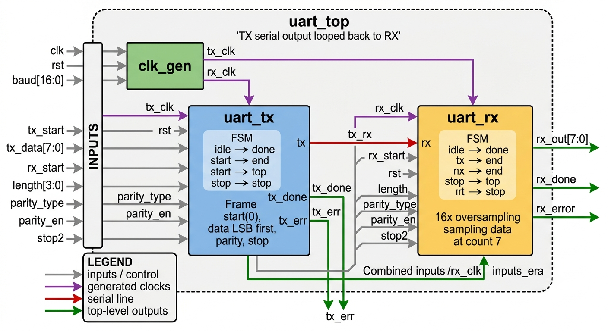
</p>
<p align="center"><em>Figure 1: UART top-level block diagram with all input and output signals</em></p>

`uart_top` is built from three blocks. The serial output of the transmitter is looped back to the receiver, so one testbench can check the complete TX to RX path.

| Block | Role | Inputs | Outputs |
|---|---|---|---|
| `clk_gen` | Generates the two baud clocks from `clk`, selected by `baud` | `clk`, `rst`, `baud[16:0]` | `tx_clk`, `rx_clk` |
| `uart_tx` | Serialises `tx_data` into a frame | `tx_clk`, `tx_start`, `rst`, `tx_data[7:0]`, `length[3:0]`, `parity_type`, `parity_en`, `stop2` | `tx`, `tx_done`, `tx_err` |
| `uart_rx` | Samples the serial line and rebuilds the byte | `rx_clk`, `rx_start`, `rst`, `rx`, `length[3:0]`, `parity_type`, `parity_en`, `stop2` | `rx_out[7:0]`, `rx_done`, `rx_error` |

⬜ Clock generation and 16x oversampling

`clk_gen` toggles `tx_clk` and `rx_clk` each time a counter passes the limit selected by `baud`. `rx_clk` runs about **16 times faster** than `tx_clk`, so the receiver gets 16 clock ticks for every transmitted bit and can sample each bit near its centre.

<details>
<summary><b>Baud-rate divider table</b> (click to expand)</summary>

| baud | rx_max | tx_max |
|---|---|---|
| 4800 | 651 | 10416 |
| 9600 (default) | 325 | 5208 |
| 14400 | 217 | 3472 |
| 19200 | 163 | 2604 |
| 38400 | 81 | 1302 |
| 57600 | 54 | 868 |
| 115200 | 27 | 434 |
| 128000 | 24 | 392 |

</details>

⬜ Transmitter FSM (`uart_tx`)

`idle → start_bit → send_data → send_parity → send_first_stop → send_sec_stop → done`

- Places one bit on `tx` at every `tx_clk` edge, **least significant bit first**.
- The parity bit is the XOR of the data bits when `parity_type = 1`, and the XNOR when `parity_type = 0`.
- Pulses `tx_done` when the last stop bit has been sent.

⬜ Receiver FSM (`uart_rx`)

`idle → start_bit → recv_data → check_parity → check_first_stop → check_sec_stop → done`

- Counts `0..15` for every bit and **samples at count 7, the middle of the bit**.
- Re-checks that `rx` is still 0 at count 7 of the start bit, which rejects glitches.
- Shifts the received bits into `datard` and loads `rx_out` after the last data bit.
- Checks parity and stop bit(s) and reports a mismatch on `rx_error`.
- Pulses `rx_done` when the frame is complete.

⬜ RTL schematic after synthesis

<p align="center">
  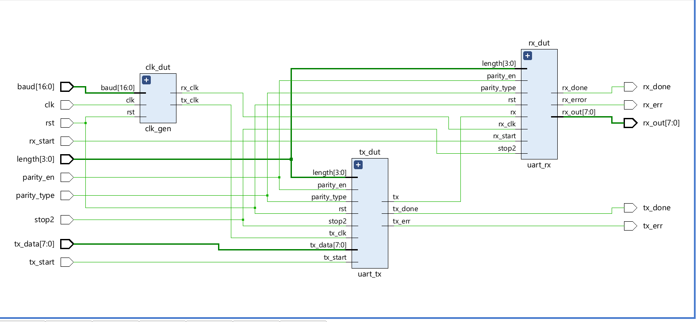
</p>
<p align="center"><em>Figure 2: UART schematic generated by Vivado after synthesis</em></p>

⬜ 1.3 Signal waveforms

⬜ Simulation waveform

<p align="center">
  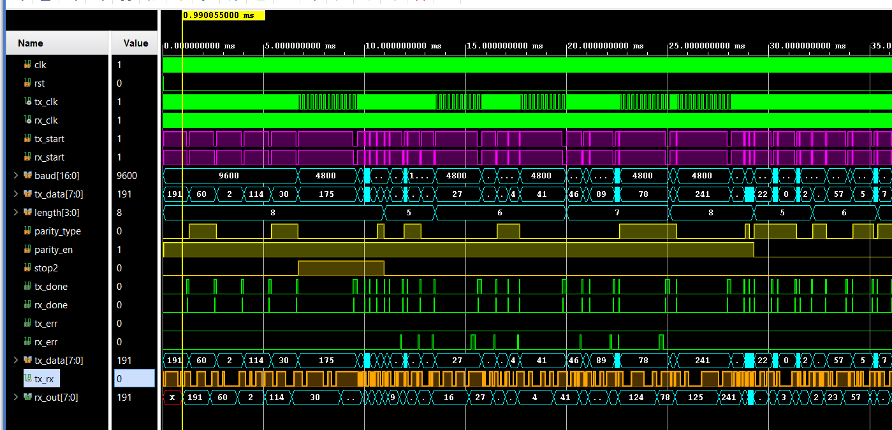
</p>
<p align="center"><em>Figure 3: UART simulation waveform showing the TX frame and RX reception</em></p>

⬜ Internal signals and data transformation

<p align="center">
  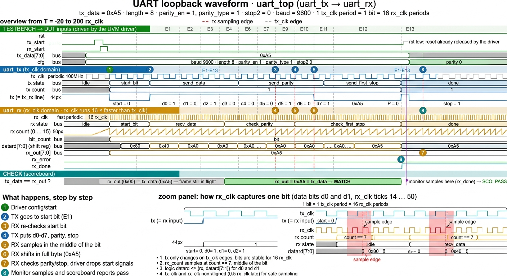
</p>
<p align="center"><em>Figure 4: Internal signals showing how <code>tx_data</code> is serialised and rebuilt as <code>rx_out</code></em></p>

**How one frame travels from TX to RX:**

1. The testbench applies `tx_data`, `baud`, `length`, the parity and stop-bit settings, and then raises `tx_start` and `rx_start`.
2. `uart_tx` leaves `idle` on the next `tx_clk` edge and `tx` falls to 0, which is the start bit.
3. `uart_rx` sees `rx = 0`, enters `start_bit` and begins counting `0..15` on `rx_clk`.
4. `uart_tx` shifts out one data bit per `tx_clk` period, LSB first, followed by the parity bit and the stop bit.
5. Every bit lasts 16 `rx_clk` periods, so `uart_rx` samples it at count 7 and shifts it into `datard`.
6. After the last data bit `rx_out` is loaded, `tx_done` and `rx_done` pulse, and the testbench drops `tx_start` and `rx_start`.
7. The scoreboard compares `rx_out` with `tx_data` (masked to `length` bits).

⬜ 1.4 UVM environment

<p align="center">
  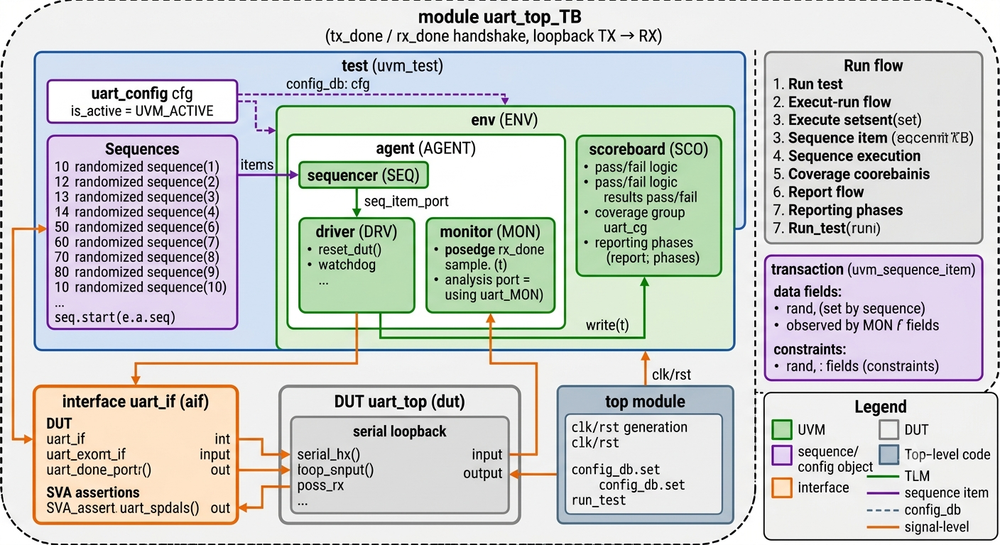
</p>
<p align="center"><em>Figure 5: UART UVM verification environment</em></p>

| Component | Description |
|---|---|
| `uart_config` | Configuration object (agent active or passive) |
| `oper_mode`, `transaction` | Operation enum, and the sequence item that carries `baud`, `length`, `parity_type`, `parity_en`, `stop2`, `tx_data`, the results and the status |
| **10 sequences** | Constrained-random and directed sequences of 5 frames each, covering different baud rates, data lengths, parity and stop-bit settings |
| `driver` | Resets the DUT, applies the configuration, raises `tx_start` and `rx_start`, and waits for `tx_done` and `rx_done` |
| `monitor` | Samples the interface when `rx_done` rises and sends the transaction through an analysis port |
| `scoreboard` | Checks that `tx_data` (masked to `length`) equals `rx_out` and that `rx_err` is not set; collects the coverage |
| `agent`, `env`, `test` | Standard UVM hierarchy; the test starts all sequences |
| `uart_if` | Virtual interface with SVA, cover properties and a report function |

**Driver handshake:** reset → release → wait → apply configuration → `tx_start` / `rx_start` = 1 → drop each one when its `done` pulses → wait for both to fall → gap → next frame.

⬜ 1.5 Assertions and coverage

- **SVA** in the interface check the handshake and pulse behaviour of the DUT signals.
- **Cover properties** confirm that the key scenarios really happened.
- **Functional coverage** (scoreboard covergroup) samples the baud rate, data length, parity setting, stop bits and the results.
- **`report_phase`** prints the scoreboard summary, the coverage and the assertion report.

⬜ 1.6 Simulation report (Vivado Tcl console)

<p align="center">
  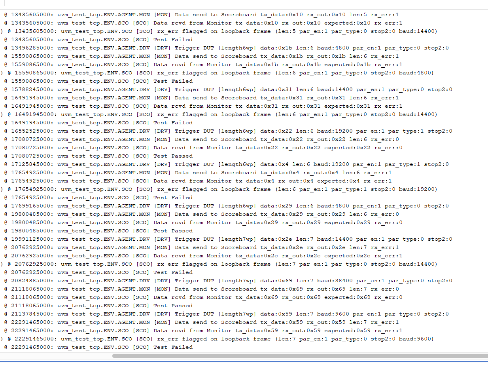
</p>
<p align="center"><em>Figure 6: UART Tcl console report (1/2)</em></p>

<p align="center">
  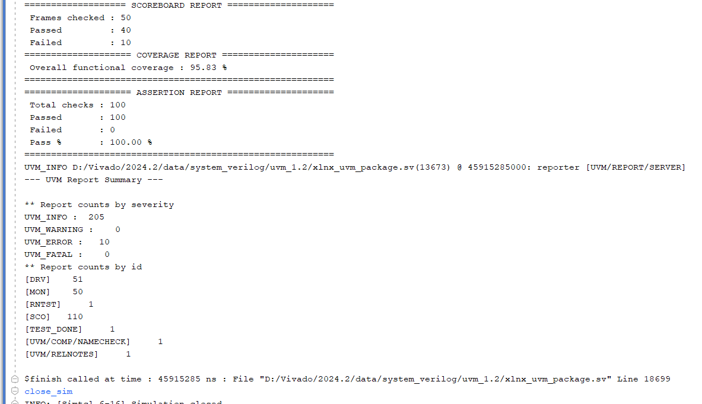
</p>
<p align="center"><em>Figure 7: UART Tcl console report (2/2) with the scoreboard, coverage, assertion and UVM summary</em></p>

| Metric | Result |
|---|---|
| Frames checked | 50 |
| Passed / Failed | 40 / 10 |
| Functional coverage | 95.83 % |
| Assertion checks | 100 passed, 0 failed |
| UVM_ERROR / UVM_FATAL | 10 / 0 |

> **Note:** 10 of the 50 frames report a data mismatch in this run, and the failures are being analysed. Candidate causes found while reviewing the RTL are listed in the next section.

⬜ 1.7 Design notes from the RTL review

These observations come from reading the RTL and are to be confirmed in simulation:

- `tx_err` is declared but is never set by `uart_tx`.
- In `uart_rx` the parity is computed over the whole 8-bit `datard`, so for `length < 8` with parity enabled it may not match the transmitter's parity, which uses only `length` bits.
- At 115200 and 128000 baud the rounded divider values make the 16x ratio only approximate.

---

# Part 2: I2C (1 master, 3 slaves)

⬜ 2.1 What is verified

I2C is a two-wire, open-drain bus with a clock line (**SCL**) and a data line (**SDA**). The testbench verifies one master communicating with **three slaves** on the same bus:

- A 7-bit address `{slave_id[1:0], location[4:0]}`: ID `01` selects slave1, `10` slave2, `11` slave3, and `00` means **no slave**, which must produce a NACK.
- Single-byte **write** (`wr = 1`) and single-byte **read** (`wr = 0`).
- START and STOP conditions, the address ACK, the data ACK, and the master NACK at the end of a read.

⬜ 2.2 DUT architecture

<p align="center">
  
</p>
<p align="center"><em>Figure 8: I2C top-level block diagram with one master and three slaves on a shared SCL/SDA bus</em></p>

| Block | Role |
|---|---|
| `i2c_master` | FSM with the states `IDLE, START, ADDR, ACK1, WDATA, ACK2, RDATA, MACK, STOP, DONE`. A tick occurs every `DIV = 4` clocks, with 4 phases per SCL bit. SDA is driven open-drain through `sda_low`. |
| `i2c_slave` (x3) | Generic slave core with a 32 x 8 memory. A slave responds only when `addr[6:5]` equals its `ID`. |
| `slave1`, `slave2`, `slave3` | IDs `2'b01` (0x20 to 0x3F), `2'b10` (0x40 to 0x5F) and `2'b11` (0x60 to 0x7F) |
| `i2c_top` | One master and three slaves sharing SCL and SDA (`tri1`, pulled up) |

**Top-level ports:** inputs `clk`, `rst`, `wr`, `addr[6:0]`, `din[7:0]`; outputs `datard[7:0]`, `done` (1-clock pulse) and `err` (1 = NACK).

**Behaviour:**

- The master latches `wr`, `addr` and `din` at the start of each transfer.
- A write sends the address and the data and expects an ACK after each byte; a read receives one byte into `datard`.
- If no slave acknowledges the address, the master sets `err = 1` and ends the transfer with a STOP.
- Slave memories are cleared by reset.

⬜ RTL schematic after synthesis

<p align="center">
  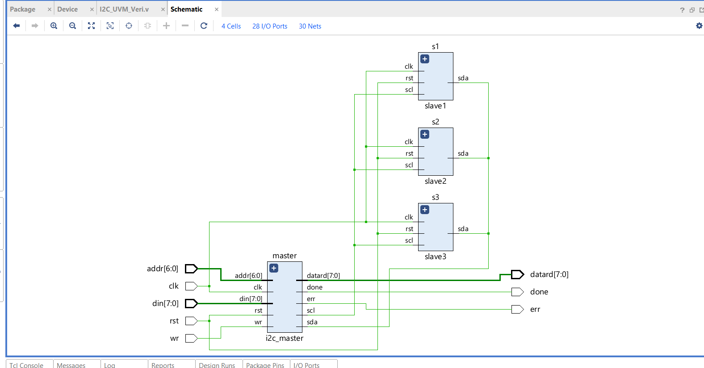
</p>
<p align="center"><em>Figure 9: I2C schematic generated by Vivado after synthesis</em></p>

⬜ 2.3 Signal waveforms

⬜ Simulation waveform

<p align="center">
  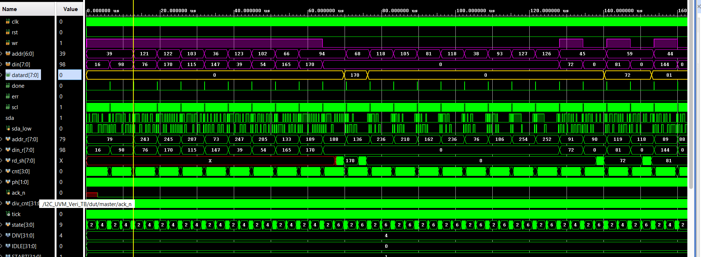
</p>
<p align="center"><em>Figure 10: I2C simulation waveform showing START, address, ACK, data and STOP</em></p>

⬜ Internal signals and data transformation

<p align="center">
  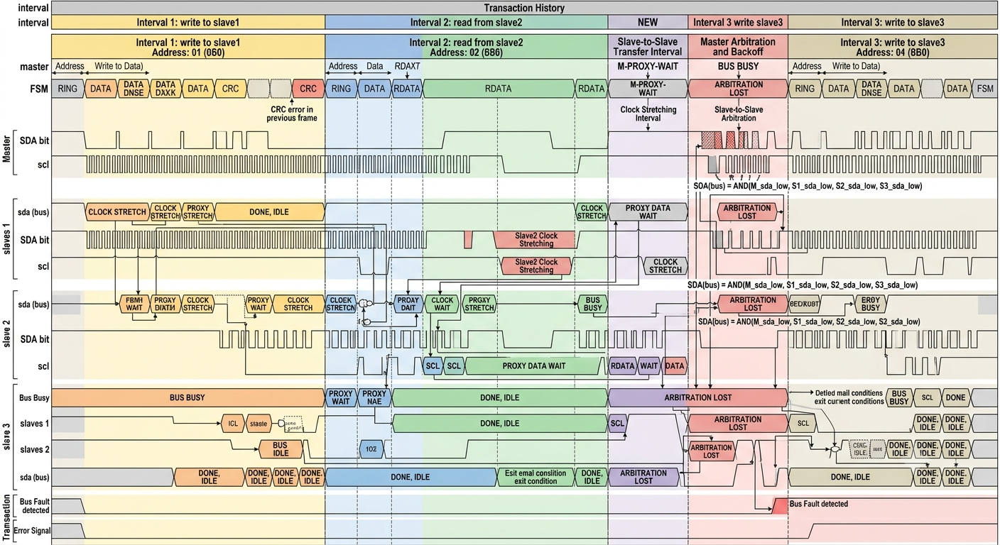
</p>
<p align="center"><em>Figure 11: Internal signals showing how the master and the slave exchange the address and data bits</em></p>

The waveforms show the START condition (SDA falls while SCL is high), the address and `wr` bit sent MSB first, the slave ACK, the data byte, the final ACK or master NACK, the STOP condition (SDA rises while SCL is high) and the `done` pulse.

⬜ 2.4 UVM environment

<p align="center">
  
</p>
<p align="center"><em>Figure 12: I2C UVM verification environment</em></p>

| Component | Description |
|---|---|
| `transaction` | Fields `op`, `wr`, `addr`, `din`, `datard`, `done` and `err`; `addr[6:5]` is the slave ID and `addr[4:0]` is the memory location |
| **Sequences** | `reset_dut`, `write_data`, `read_data`, `wr_rd_slave` (write then read back, one slave at a time, run for all 3 slaves), `write_err` and `read_err` (address with no slave) |
| `driver` | Reset, write and read tasks; waits for `vif.done` |
| `monitor` | Samples `wr`, `addr` and `din`, and after `done` samples `err` and `datard` |
| `scoreboard` | Reference memory model; checks the NACK for the no-slave address, the ACK for valid slaves, and `datard == expected` on every read |
| `agent`, `env`, `test` | Standard UVM hierarchy |
| `i2c_i` | Virtual interface with SVA, cover properties and a report function |

⬜ 2.5 Assertions and coverage

- **SVA** in the interface check the `done` and `err` behaviour, the reset state, and that the outputs and inputs are never X or Z.
- **Cover properties** confirm that the `done` and `err` scenarios happen.
- **Functional coverage** samples the operation (write or read), the slave ID (no slave, slave1, slave2, slave3), the memory-location ranges, ACK or NACK, and a cross of slave and operation.
- **`report_phase`** prints the scoreboard summary, the coverage and the assertion report.

⬜ 2.6 Simulation report (Vivado Tcl console)

<p align="center">
  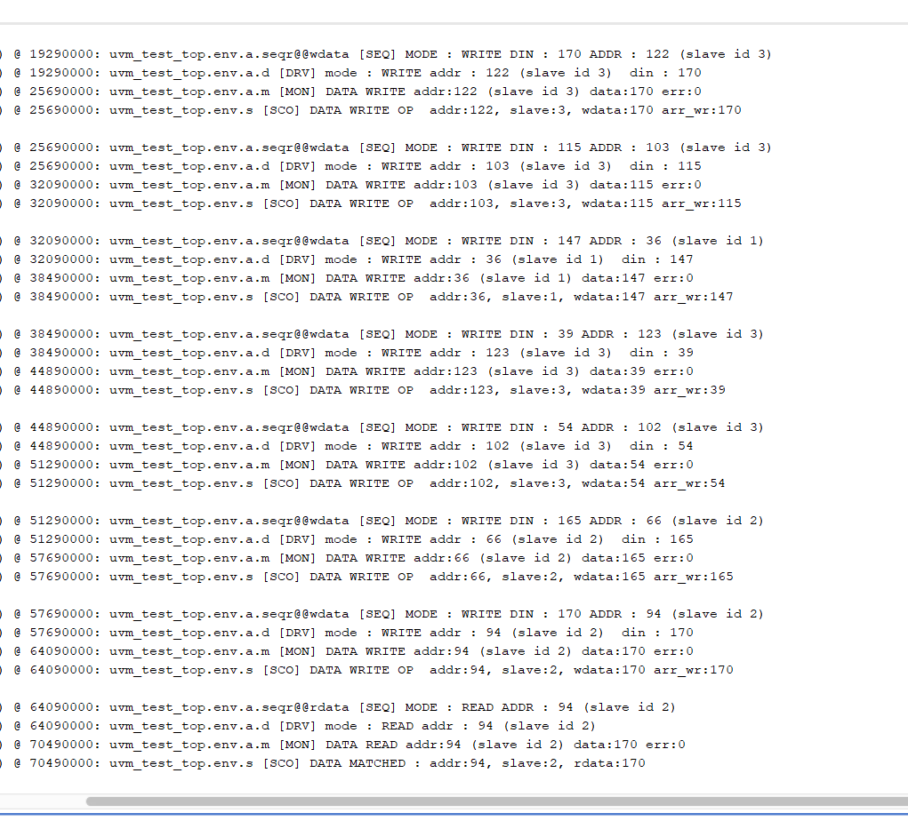
</p>
<p align="center"><em>Figure 13: I2C Tcl console report (1/2)</em></p>

<p align="center">
  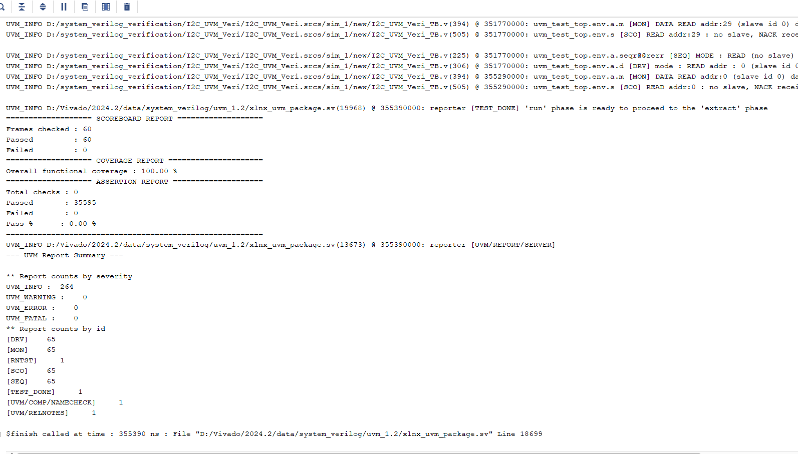
</p>
<p align="center"><em>Figure 14: I2C Tcl console report (2/2) with the scoreboard, coverage, assertion and UVM summary</em></p>

| Metric | Result |
|---|---|
| Frames checked | 60 |
| Passed / Failed | 60 / 0 |
| Functional coverage | 100.00 % |
| Assertion checks passed / failed | 35595 / 0 |
| UVM_ERROR / UVM_FATAL | 0 / 0 |
| Simulation end time | 355,390 ns |

---

⬜ Results summary

| Design | Frames checked | Passed | Failed | Functional coverage | Assertions (pass / fail) |
|---|---|---|---|---|---|
| **UART (TX / RX)** | 50 | 40 | 10 | 95.83 % | 100 / 0 |
| **I2C (1 master, 3 slaves)** | 60 | 60 | 0 | 100.00 % | 35595 / 0 |

⬜ How to run

**Vivado (xsim)**

1. Download the code for the design from the [download section](#download-the-full-code) and create a Vivado project.
2. Add the RTL file and the testbench file, and set the testbench module as the simulation top (`uart_top_TB` for UART, `tb` for I2C).
3. Run the behavioural simulation. The UVM report appears in the Tcl console.

**Command line (xsim)**

```bash
xvlog -sv -L uvm <rtl_file>.sv <tb_file>.sv
xelab -L uvm <top_module> -s sim
xsim sim -R
```

> Make sure the `interface` definition is not duplicated in both the RTL file and the testbench file.

**Tools:** SystemVerilog · UVM 1.2 · Vivado 2024.2 (xsim)

---

⬜ Author

<table>
  <tr>
    <td>
      <h3><a href="https://www.linkedin.com/in/rabisankar-maity-98572b1b7">Rabisankar Maity</a></h3>
      <p><b>RTL Design Engineer</b> | M.Tech VLSI @ IIT Guwahati '26 (GATE AIR 318)</p>
      <p>Verilog • SystemVerilog • FPGA • SoC PL+PS Integration<br>
      Creator of a Full VGG-16 Hardware Accelerator and a RISC-V Core<br>
      UVM Verification and IP Integration</p>
      <p>Indian Institute of Technology, Guwahati</p>
      <p>
        <a href="https://github.com/vijay-2020-vijay"></a>
        <a href="https://www.linkedin.com/in/rabisankar-maity-98572b1b7"></a>
      </p>
    </td>
  </tr>
</table>

If you find this project useful, please consider giving the repository a star.
